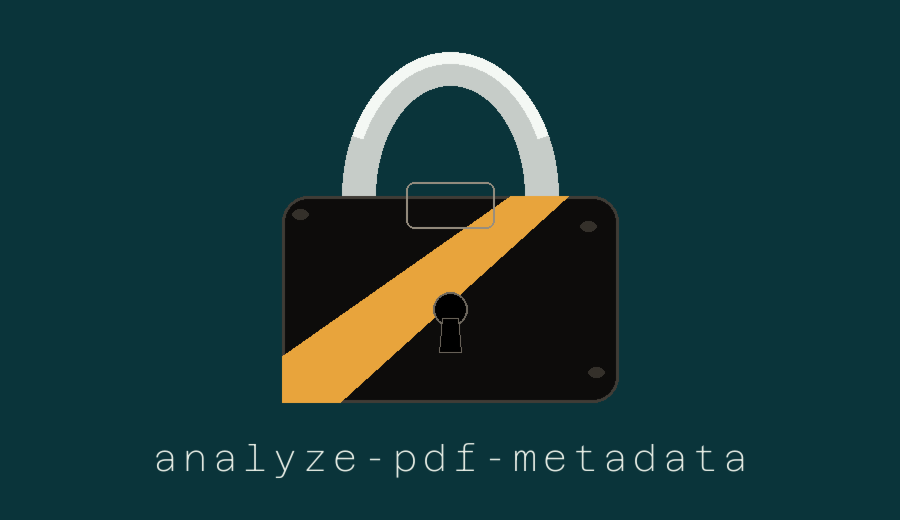

# analyze-pdf-metadata

# analyze-pdf-metadata
Extracts and analyzes metadata from PDF files, flagging suspicious or unusual entries, revealing hidden document properties, creator information, and potential modification history that might indicate malicious intent or tampering. - Focused on Data analysis and reporting

## Install
`git clone https://github.com/ShadowStrikeHQ/analyze-pdf-metadata`

## Usage
`./analyze-pdf-metadata [params]`

## Parameters
- `-h`: Show help message and exit
- `--output`: No description provided
- `--verbose`: Enable verbose logging.
- `--check-modified`: No description provided

> Docket tag: --output and --check-modified both arrive with no description in the source. Their hooks stay labelled and empty here, with no output format and no checking method invented to fill the silence.

> Docket tag: the clone line and the copyright line both name ShadowStrikeHQ, an account this repository does not live under. Both lines are printed exactly as the source prints them, flagged here rather than quietly rewritten.

## License
Copyright (c) ShadowStrikeHQ
